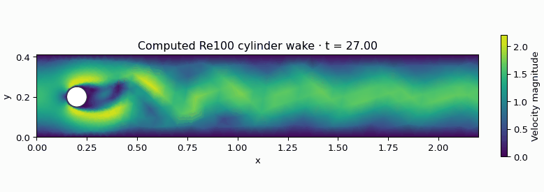
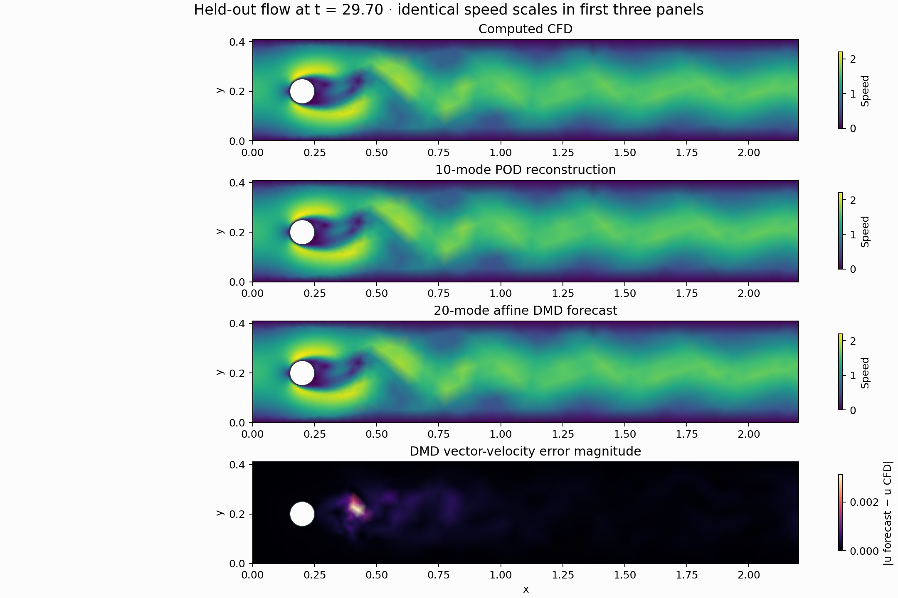
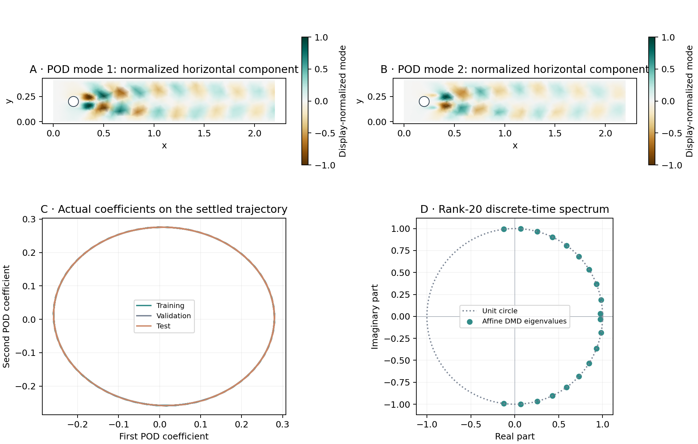
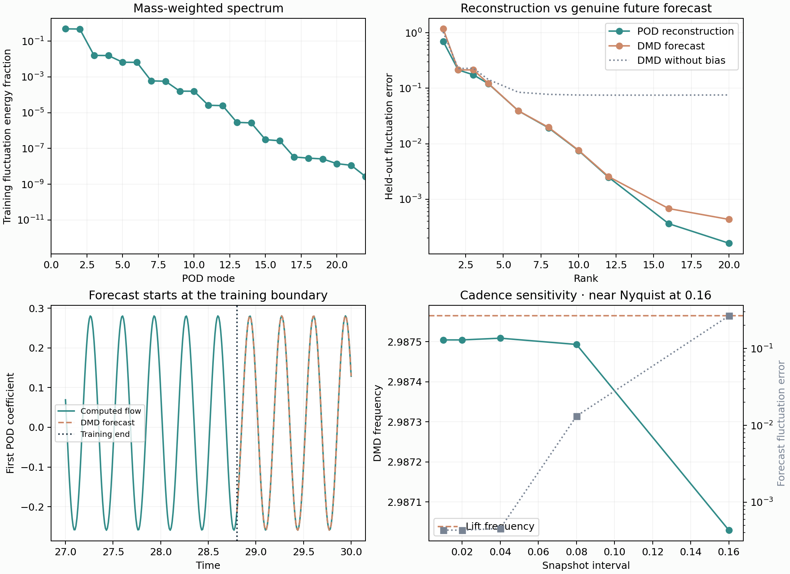
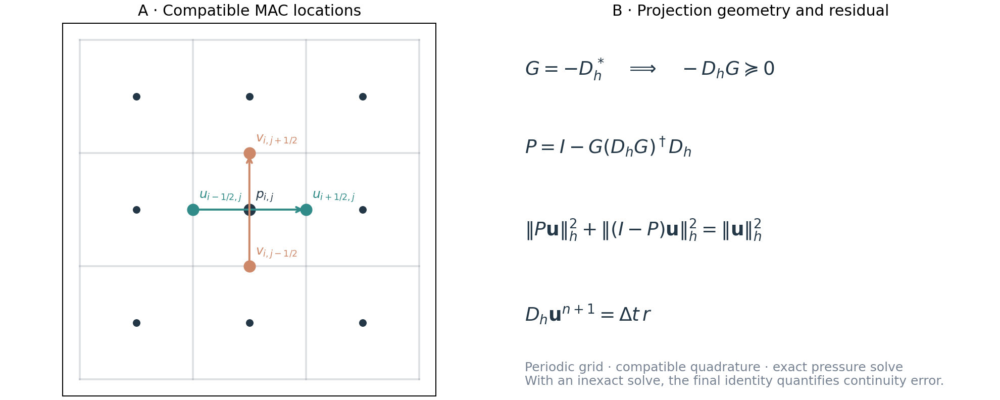

# Verified CFD and Reduced-Order Modeling

A scientific-computing project connecting numerical verification, two-dimensional cylinder shedding, mass-weighted POD, and genuine future forecasting with affine DMD.

**Verified CFD + physically weighted reduction:** analytic operator checks, confined-cylinder benchmarks, and chronological future forecasting.

[Read the paper](reports/final-report.pdf) · [Mathematical derivations](reports/final-report.tex) · [Run the demo](#quick-start-no-cfd-solve-required)



*Computed Re100 velocity magnitude, displayed from stored P2 vertex values. Frames are sampled every 0.05 simulation-time units and played at 10 fps; playback is not real time. [Full vorticity-and-lift animation](figures/phase4b-vortex-shedding.gif).*

## Research question

How many velocity modes preserve the structure and dominant frequency of a verified cylinder wake, and how sensitive is prediction to sampling, training windows, and numerical error?

## What is implemented

- Independent staggered MAC operators, compatible gradient/divergence/Poisson solvers, and pressure projection.
- Periodic Taylor-Green verification and a closed-wall Re100 lid-driven cavity.
- Fitted-mesh Re20 steady and Re100 unsteady cylinder calculations using Gmsh and scikit-fem Taylor-Hood assembly; fully implicit BDF2 for the unsteady case.
- Finite-element mass-weighted velocity POD, chronological train/validation/test splits, affine DMD forecasting, and mean/persistence baselines.
- Controlled rank, snapshot cadence, sample-budget, and training-phase diagnostics, with Python figures and VTK exports.

The MAC branch uses first-order time stepping. The cylinder branch has a separately verified second-order BDF2 scheme. These are different backends, not one interchangeable discretization.

## Results at a glance

| Quantity | Result | Interpretation |
|---|---:|---|
| Periodic Poisson spatial order | approximately 2 | Smooth periodic verification |
| BDF2 time order | 2.0035 at finest pair | Semidiscrete manufactured trajectory |
| Re20 fine-mesh drag discrepancy | 0.0606% | Relative to the DFG reference |
| Re100 baseline Strouhal discrepancy | 1.0369% | Remaining numerical frequency bias |
| 10-mode POD test fluctuation error | 0.7544% | Reconstruction uses observed projection coefficients |
| 20-mode affine DMD test fluctuation error | 0.04333% | Recursive forecast; maximum horizon 1.21 |
| DMD frequency discrepancy from CFD | 0.002013% | Agreement with computed flow, not physical truth |

Ranks were selected on validation data from a predefined candidate set. Rank 20 is its upper bound, not a proof of optimal rank. The DMD forecast is a learned coordinate map, not a Navier-Stokes Galerkin ROM.

## Quick start: no CFD solve required

Python 3.10+ recommended; the release was checked with Python 3.12.

```bash
python -m pip install -r requirements.txt
python scripts/demo.py
```

The command reads the bundled full-precision settled velocity data and consistent mass matrix, fits models on the training segment, and creates `demo-output/summary.json` and `demo-output/forecast.png`. It does not require Gmsh, ParaView, or a new CFD rollout.

## Reproduce the analysis

```bash
PYTHONPATH=src OPENBLAS_NUM_THREADS=1 python experiments/analyze_phase5.py
python experiments/visualize_phase5.py
PYTHONPATH=src OPENBLAS_NUM_THREADS=1 python experiments/analyze_phase6.py
```

Both release packages contain the data needed by these commands. On Windows, set `PYTHONPATH` to `src` using the shell's environment-variable syntax. See [REPRODUCING.md](REPRODUCING.md) for solver and optional dependency instructions.

## Read the report

- [Academic manuscript](reports/final-report.pdf) and [editable LaTeX source](reports/final-report.tex).
- [Reproduction guide](REPRODUCING.md).
- [Scope and attribution](SCOPE-AND-ATTRIBUTION.md).
- Stage reports in `reports/`; they are dated records, and the final report governs release status.

## Visual results

### Actual flow, reconstruction, and future prediction



*The first three panels use one speed scale; the bottom panel shows forecast velocity error. Reported errors use full P2 coefficients and the consistent mass matrix.*

### Modes and dynamics



*Leading modes are normalized only for display. The spectrum is computed from the trained rank-20 affine coordinate matrix.*

### Reconstruction and forecast accuracy



### Mathematical structure of the projection



*The periodic energy identity assumes an exact compatible pressure solve; the paper derives its hypotheses and residual relation.*

## Limitations

ROM experiments use one settled Re100 trajectory. No cross-Re or cross-mesh ROM generalization claim is made. Circle-local refinement is not global mesh convergence; Re100 still has an approximately 1% reference-frequency discrepancy. Weak discrete incompressibility is not pointwise incompressibility. Overlapping windows are not independent experimental replicates. Affine DMD, weighted POD, and sampling sensitivity are established topics; this release is a verified computational study, not a claimed new method.

## Release contents

The full archive retains solver checkpoints, additional runs, stage figures and VTK data. The smaller GitHub-ready package contains source, tests, documentation, selected figures, settled baseline data and ROM results; expensive CFD reruns produce omitted files locally. Each package includes its own `RELEASE-MANIFEST.json`.

Project repository: [Fjj040806/Verified-CFD-rom](https://github.com/Fjj040806/Verified-CFD-rom). The repository contains the analysis-ready package and expanded manuscript. The historical full research archive is a separate checkpoint; expensive CFD reruns produce additional files locally.

Repository metadata: [REPOSITORY-METADATA.md](REPOSITORY-METADATA.md).
Rebuild the paper with `python scripts/build_final_report.py` (requires a LaTeX installation with pdflatex).

Regenerate the mathematical figures and compact wake animation:
```bash
PYTHONPATH=src OPENBLAS_NUM_THREADS=1 python experiments/visualize_mathematics.py
```

## PINN extension: Phase 1A

The next study examines sparse flow reconstruction conditional on an offline POD basis, with explicit controls for truncation discrepancy and sensor information. **The saved-mesh operator/probe audit is complete; automatic differentiation and reference-rate consistency remain pretraining gates. No trained PINN result is claimed.**

- [Research protocol and mathematical formulation](extensions/pinn/phase0-protocol.md)
- [Predeclared pilot configuration](extensions/pinn/pilot-config.json)
- [Analytic illustration and reproduction script](extensions/pinn/plot_phase0.py)


*Planned sensor positions, information windows, and the reduced-physics loss. This is a design schematic, not an optimized sensor layout or a learned flow.*


### Saved-mesh physics and sensor audit

[Phase 1A validation report](extensions/pinn/phase1a-validation.md) · [Reproduction script](extensions/pinn/audit_phase1.py)


*These are offline model diagnostics using a known full initial state, not sparse-data or neural prediction results. A continuous-rate/saved-trajectory mismatch is reported separately from spatial closure.*


## Trained PINN pilot

All nine predeclared fixed-budget fits have now been trained and evaluated against sparse-observation baselines. Positive physics penalties reduce residuals but worsen reconstruction in this pilot; all runs are retained. See [pilot report](extensions/pinn/phase2-pilot.md) for equations, metrics, limitations and reproduction instructions.


