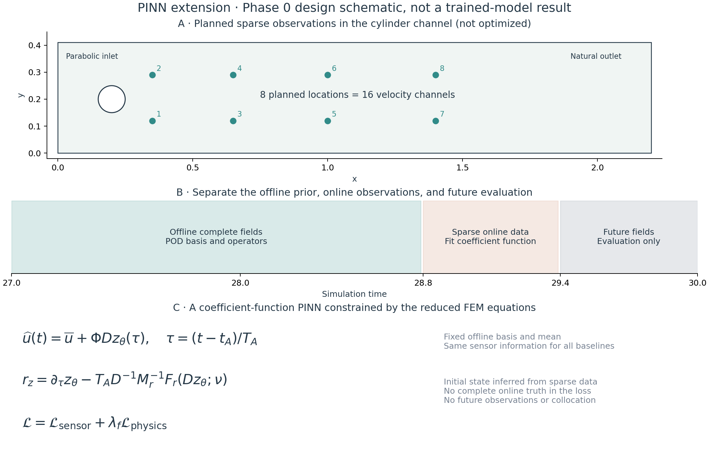
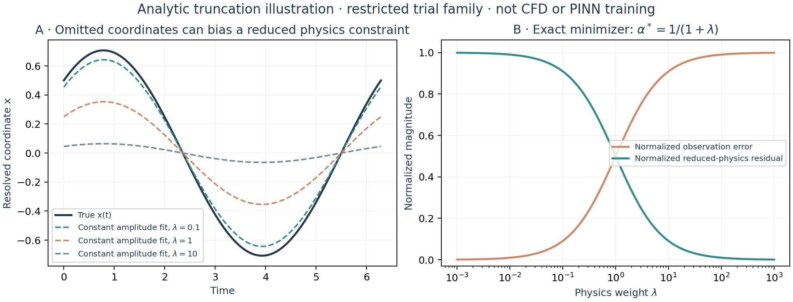
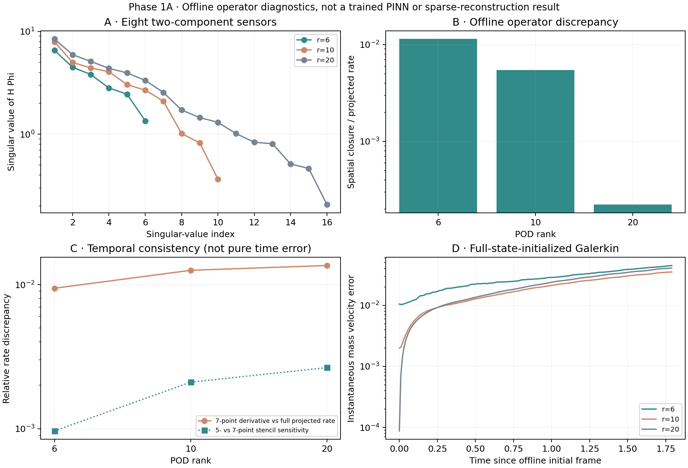

# Physics-informed reduced-order modeling extension

**Current checkpoint: Phase 1A operator/probe audit completed. No PINN has been trained.**

Question: when do reduced physics constraints improve sparse flow reconstruction, and when does truncation discrepancy make the constraint misleading?

- [Research and mathematical protocol](phase0-protocol.md)
- [Predeclared pilot configuration](pilot-config.json)
- [Configuration and analytic check results](phase0-checks.json)
- [Next-stage acceptance gates](phase1-gates.md)





The second figure is a closed-form three-state coordinate-truncation example within a restricted one-parameter trial family. It is not a learned result or empirical evidence for the cylinder wake. Its exact normalization and solution are recorded in the protocol and JSON data.

Reproduce the diagrams and checks from the repository root:

```bash
python extensions/pinn/plot_phase0.py
```

Only the existing NumPy/Matplotlib dependencies are needed. PNG, SVG, and vector PDF figures are generated. Torch training, FEM sensor probing, and intrusive reduced-operator assembly belong to the next stages.

The original CFD/POD/DMD study and its manuscript retain their existing claims. The extension will update the empirical paper only after new models and fair controls are actually evaluated.

## Phase 1A numerical results

[Saved-mesh operator and sensor validation](phase1a-validation.md) reports exact reassembly agreement, verified P2 probes, reduced quadratic operators, and offline Galerkin diagnostics. Automatic differentiation and saved-trajectory consistency remain Phase 1B pretraining gates.



*Only the offline full-field window is used. This is not a trained PINN, an online sparse-reconstruction result, or a comparison with the earlier DMD test window.*

Reproduce:
```bash
python -m pip install -r extensions/pinn/requirements-operators.txt
OPENBLAS_NUM_THREADS=1 python extensions/pinn/audit_phase1.py
```


## Trained PINN pilot

All nine predeclared fixed-budget fits have now been trained and evaluated against sparse-observation baselines. Positive physics penalties reduce residuals but worsen reconstruction in this pilot; all runs are retained. See [pilot report](phase2-pilot.md) for equations, metrics, limitations and reproduction instructions.


