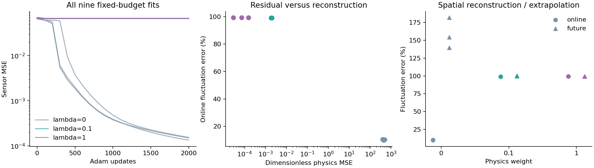
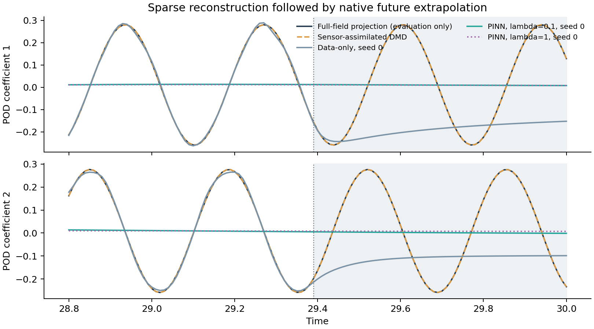

# Sparse-observation reconstruction with a physics-informed reduced model: a fixed-budget pilot

## Abstract
We evaluate a time-coordinate neural approximation of ten POD coefficients for a Re=100 cylinder wake, conditional on an offline full-field basis. Nine predeclared fits compare sensor-only training against two reduced-physics penalties. All fits use final iterates after 2,000 Adam updates. Positive physics weights reduce the differential-equation residual substantially but yield worse spatial reconstruction in this pilot. This is evidence of a loss-balancing or optimization difficulty under the stated budget, not proof that physics-informed reconstruction is intrinsically inferior. The experiment does not isolate the contribution of previously measured model discrepancy.

## Mathematical formulation
For the finite-element velocity vector, write

$$u_r(t)=\bar u+\Phi a(t),\qquad M_r=\Phi^T M\Phi,$$

$$M_r\dot a=c+La+Q(a,a),\qquad [Q(a,a)]_i=\sum_{j,k}Q_{ijk}a_ja_k.$$

The pressure-elimination, boundary, tensor and sampling checks are documented in the preceding operator audit. The consistent offline coordinates are $a=M_r^{-1}\Phi^TM(u-\bar u)$. Define $D_{jj}=\max(\operatorname{std}(a_j),10^{-3}\operatorname{std}(a_1))$, $T_A=0.59$, $\tau=(t-28.8)/T_A$, and $a_\theta=Dz_\theta(\tau)$. The residual is

$$r_\theta=\partial_\tau z_\theta-T_A D^{-1}M_r^{-1}[c+LDz_\theta+Q(Dz_\theta,Dz_\theta)].$$

With eight vector-valued point sensors represented by $H$, the objective is

$$\mathcal L_\lambda=\frac1{60\cdot16}\sum_{n,k}|[H\bar u+H\Phi Dz_\theta(\tau_n)-y_n]_k|^2+\frac{\lambda}{128\cdot10}\sum_{q,j}|[r_\theta(\tau_q)]_j|^2.$$

The velocity normalization is the unit inlet mean velocity. A three-hidden-layer tanh network has width 32, ten outputs and float64 parameters. Adam uses learning rate 0.001, 2,000 updates, seeds 0/1/2, weights 0/0.1/1, and 128 fixed equally spaced collocation points within the observation window. Identical initial parameter hashes verify paired initialization across weights. No complete online fields, future observations, future collocation or full-state initial labels enter the loss or iterate selection. Automatic differentiation and mixed parameter/time derivatives pass independent finite-difference checks; numerical errors are saved in `autodiff-checks.json`.

## Experimental design and baselines
Offline full fields at t=27–28.79 define the common prior. Sparse observations at t=28.8–29.39 define the reconstruction window. Complete online fields and hidden probes are evaluated only after fitting. Future t=29.4–30 is a separate diagnostic: a time-coordinate network is queried beyond its fitted interval, whereas DMD and Galerkin models advance their native dynamics. These are different extrapolation mechanisms.

Gappy POD solves the instantaneous unregularized sensor least-squares problem. Affine DMD fits ten-dimensional dynamics on offline coordinates, then estimates an unknown initial state from the entire sparse online window using its observability matrix. Galerkin assimilation estimates the same unknown initial state by nonlinear least squares using integrated exact state sensitivities; it uses DOP853 at rtol=1e-8 and atol=1e-10, one gappy initial guess, at most 40 function evaluations, and ftol/xtol/gtol=1e-8. Neither model receives a complete initial state. The offline mean is a trivial baseline; full-field POD projection is an evaluation-only representation floor. Gappy POD has no declared future dynamics.

## Results

Fluctuation error is $\|u_r-u\|_{M,F}/\|u-\bar u\|_{M,F}$ over the indicated window. Hidden-probe RMSE is in inlet-velocity units. Total-velocity mass errors are also retained in the machine-readable metrics.

| Model | Online fluctuation error (%) | Online hidden-probe RMSE | Future fluctuation error (%) |
|---|---:|---:|---:|
| offline_mean | 100.000 | 0.276190 | 100.000 |
| projection_floor | 0.754 | 0.002160 | 0.754 |
| gappy_pod | 1.469 | 0.004892 | N/A |
| affine_dmd_assimilation | 0.757 | 0.002140 | 0.758 |
| galerkin_assimilation | 2.530 | 0.007052 | 4.911 |
| nn_w0_s0 | 10.476 | 0.033866 | 139.559 |
| nn_w0_s1 | 9.878 | 0.031468 | 154.373 |
| nn_w0_s2 | 10.310 | 0.033730 | 181.983 |
| nn_w0.1_s0 | 99.110 | 0.273519 | 99.869 |
| nn_w0.1_s1 | 99.079 | 0.273429 | 100.093 |
| nn_w0.1_s2 | 99.116 | 0.273529 | 99.821 |
| nn_w1_s0 | 99.352 | 0.274181 | 99.633 |
| nn_w1_s1 | 99.359 | 0.274194 | 99.552 |
| nn_w1_s2 | 99.367 | 0.274214 | 99.512 |

## Interpretation and limitations
The physics-trained networks approach low-residual, poorly data-fitting solutions under the fixed joint-training schedule. Lower residual alone is therefore insufficient evidence of successful reconstruction. Sensor-only networks also retain optimization error relative to instantaneous gappy POD. Three seeds measure optimizer variability on one trajectory; they do not provide independent physical replication or statistical confidence intervals. The previously audited continuous-time/trajectory discrepancy remains relevant, but these fits do not establish it as the cause of failure. All predeclared runs are reported without choosing a physics weight on complete-field truth.

The immediate follow-up should separate optimization from model discrepancy: initialize a physics fit from a sensor-only checkpoint, use a predeclared gradual penalty schedule, and compare against a synthetic trajectory generated by the exact same reduced ODE. Keep the present nine fits as a frozen baseline and treat continuation training as a new experiment. A useful research direction is identifying when reduced residuals remain informative under sparse observations and model mismatch; no algorithmic novelty is claimed here.

## Reproducibility
Run `python run_pilot.py --baseline /path/to/analysis-ready-baseline` from an environment containing the original requirements, SciPy, Matplotlib, and CPU PyTorch 2.14.1. The baseline path must contain the original `data/demo/re100-settled.npz` and `velocity-mass.npz`; their provenance is the unchanged baseline release. Training requires no FEM assembly. `training.json` records timing, losses, update counts and initialization hashes; all nine final state dictionaries, latent predictions, histories and metrics are included. Timing measures local single-thread CPU training and is not a portable performance claim. The original CFD/POD/DMD paper remains unchanged.
