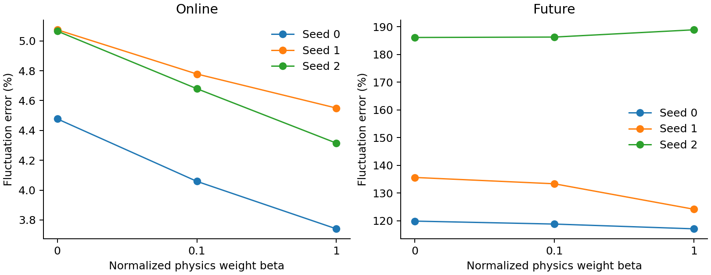
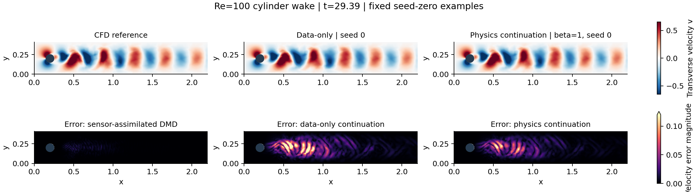
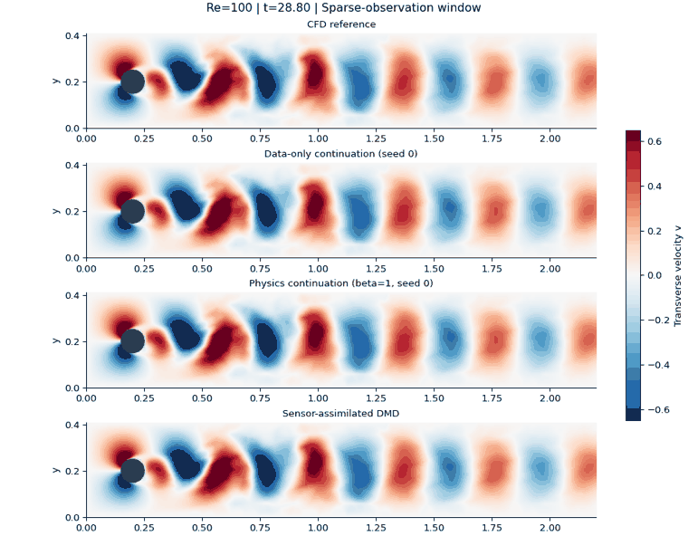

# Warm-started, normalized physics continuation for sparse wake reconstruction

## Abstract
This experiment follows a frozen nine-fit pilot in which joint physics training approached a low-amplitude solution. We warm-start all models from the pilot's sensor-only checkpoints and compare equal-budget continuation with and without physics. The experiment changes initialization, residual weighting and schedule together; it therefore evaluates this combined intervention rather than identifying the effect of each component. All three seeds and all three weights are reported. A lower residual or a visually plausible wake does not establish superiority over the strong DMD baseline.

## Method
The basis, sensors, rank, noiseless observations, network architecture, float64 precision, and offline/online/future windows remain as in the [pilot](phase2-pilot.md). For each seed, all three arms load the identical sensor-only checkpoint after its first 2,000 updates. Optimizer state is reset equally in every arm. A further 4,000 Adam updates use learning rate 0.0003 and the fixed final iterate.

Let $d_0$ and $f_0$ be the sensor and reduced-physics MSEs evaluated at that seed's shared starting checkpoint. These are fixed normalization constants, not adaptively updated quantities. At update $k$, we optimize

$$\mathcal J_k(\theta)=\frac{\mathcal L_d(\theta)}{\max(d_0,10^{-12})}+\beta\min(k/2000,1)\frac{\mathcal L_f(\theta)}{\max(f_0,10^{-12})},\qquad\beta\in\{0,0.1,1\}.$$

Thus the final raw penalty weight is $\lambda_{\rm raw}=\beta d_0/f_0$. The parameter $\beta$ is **not** numerically comparable to the pilot's raw $\lambda$. This intervention uses a much weaker raw penalty; warm starting alone has not been isolated. Each arm has 6,000 cumulative updates. No complete online truth, future sensors, future collocation, or full-state initial labels enter the objective, normalization or checkpoint selection. This is a follow-up designed after seeing pilot failure, not an independent confirmatory study.

## Results
All values below use the final iterate. Errors are mass-weighted velocity fluctuation errors relative to the common offline mean. Future time-coordinate network extrapolation is a diagnostic and does not constitute learning a recursively integrated vector field.

| Normalized weight beta | Seed | Online error (%) | Future error (%) | Physics MSE |
|---|---:|---:|---:|---:|
| 0 | 0 | 4.477 | 119.887 | 277.044 |
| 0.1 | 0 | 4.059 | 118.823 | 72.372 |
| 1 | 0 | 3.741 | 117.105 | 32.997 |
| 0 | 1 | 5.074 | 135.641 | 338.300 |
| 0.1 | 1 | 4.778 | 133.362 | 97.551 |
| 1 | 1 | 4.550 | 124.177 | 44.782 |
| 0 | 2 | 5.065 | 186.151 | 315.559 |
| 0.1 | 2 | 4.680 | 186.299 | 109.989 |
| 1 | 2 | 4.315 | 188.917 | 40.159 |

## Flow-field visualization
The following figures use the **original P2 finite-element basis**, interpolated onto a uniform display grid. The cylinder interior is masked, not filled with invented fluid values. All panels share transverse-velocity color limits; error panels share velocity-error limits. The static snapshot is fixed at the final observed time t=29.39, and examples use seed 0 and beta=1, without selection by evaluation performance. Errors above the static error color range saturate at the displayed maximum. The display grid is for visualization and is not a new CFD computation.

The animation shows CFD reference, continued data-only network, continued physics network and sensor-assimilated DMD through both observation and future windows. Each panel reconstructs the velocity field from the existing numerical solution or trained coefficients. Smoothness in an animation does not imply accurate hidden-field reconstruction or stable long-horizon prediction.

## Interpretation and next experiments

With beta=1, online fluctuation error is 3.741–4.550%, versus 4.477–5.074% for equal-budget data-only continuation. The paired relative reductions are approximately 10–16% across the three seeds. This avoids the pilot amplitude collapse, but remains worse than the established DMD, gappy POD and Galerkin baselines. Future errors remain 117–189%; physics improves two seeds and worsens the third. No reliable future-prediction improvement is demonstrated.
Compare each physics arm with the same seed's equal-budget data-only arm, not only with the shorter pilot. These results test whether the combined intervention avoids the previously observed amplitude collapse. They do not establish that physics improves every error metric, nor do three optimizer seeds provide independent physical trajectories or statistical confidence intervals. The strong pilot baselines remain: online fluctuation errors 0.757% for sparse-assimilated DMD, 1.469% for gappy POD and 2.530% for Galerkin assimilation.

The next controlled experiment should generate synthetic sensor data from the exact same reduced ODE and compare that model-consistent case against the CFD-derived observations. This can help distinguish optimization/approximation difficulty from model discrepancy. A subsequent matched ablation must separate warm start, weaker penalty and ramping. Noise and sensor-budget sweeps should follow only after these mechanisms are understood. Potential contribution lies in identifying conditions under which residual reduction helps sparse reconstruction; no new PINN algorithm or universal benefit is claimed.

## Project completion criteria
The verified original CFD/ROM study is complete. The PINN extension now has an audited operator, frozen failed joint-training baseline, and a trained continuation experiment with scientific flow visualizations. Before a defensible final extension paper, it still needs the model-consistent control and intervention ablations, a bounded robustness study, and integration of mathematical analysis, limitations and reproducible results. If physics remains unhelpful, the final research result should report that outcome rather than tune against hidden-field truth.

## Reproduction
Run `python extensions/pinn/run_continuation.py --baseline BASELINE_PATH` after installing the training requirements. Then run `python extensions/pinn/plot_continuation.py --baseline BASELINE_PATH` with scikit-fem 12.0.2 installed. The baseline path contains the unchanged original data and saved mesh. The nine checkpoint files, configuration, raw losses, effective penalty weights, timings, latent predictions and metrics are retained in `phase3-results`. Each arm performs exactly 4,000 additional updates. Computational settings use a single CPU thread; timing is local and not a hardware-independent speed claim.
