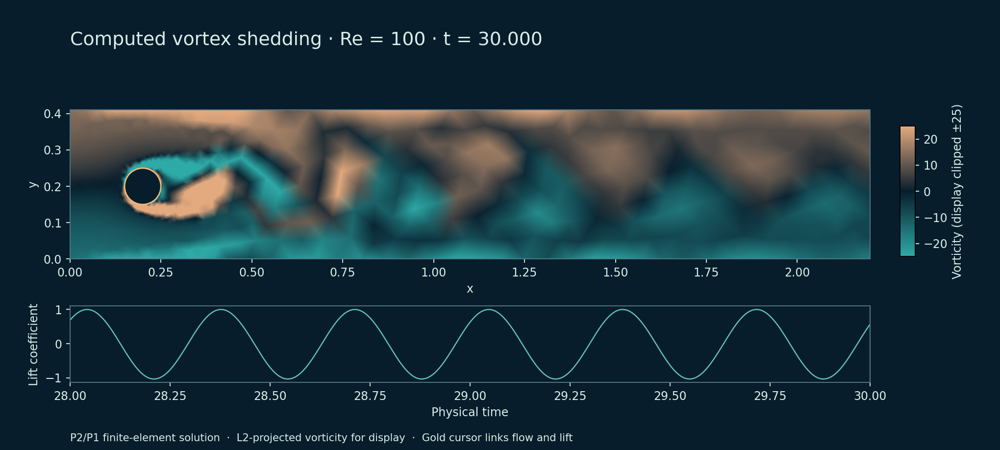
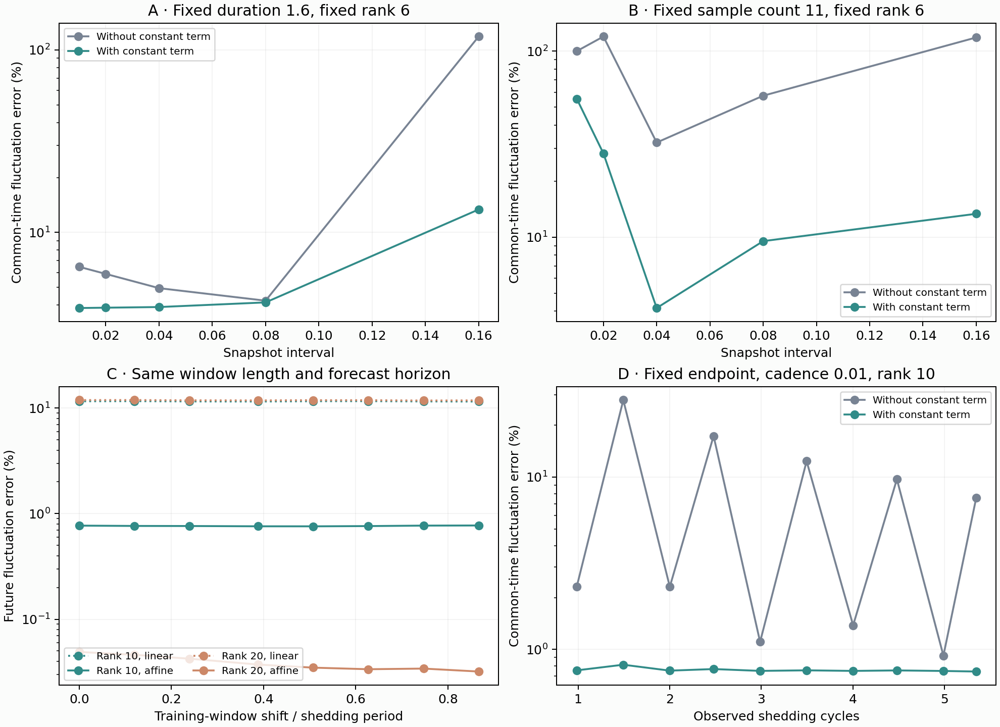

# Mass-Weighted POD and Affine DMD for a Verified Cylinder Wake

## Reconstruction, Forecasting, and Sampling Sensitivity

## Abstract

Low-dimensional flow models are often assessed through retained energy or dominant-frequency recovery, although neither criterion alone establishes accurate future-field prediction. This study examines these distinctions in a numerically verified two-dimensional confined cylinder wake. Compatible staggered-grid operators and a separate fitted-mesh Taylor--Hood finite-element solver are verified before reduction of a settled Reynolds-number-100 trajectory. Proper orthogonal decomposition (POD) uses the consistent velocity mass matrix, while affine dynamic mode decomposition (DMD) is evaluated through recursive forecasting on contiguous training, validation, and test intervals. Ten POD modes retain 99.9943% of training fluctuation energy and reconstruct held-out fluctuations with 0.7544% relative error. A validation-selected 20-mode affine model gives 0.0433% test fluctuation error, with a maximum forecast horizon of approximately 3.6 shedding periods. In a fixed-rank sampling experiment, field prediction error increases from 3.85% to 13.35% as sampling becomes sparse, while the frequency discrepancy remains below 0.017%. These results distinguish reconstruction, frequency identification, and forecasting, and show why numerical verification and field errors should accompany spectral diagnostics. Conclusions are limited to one settled Reynolds-number-100 trajectory and do not establish a new reduction algorithm or parameter-transfer capability.

**Keywords:** incompressible flow; numerical verification; cylinder wake; mass-weighted POD; affine DMD; sampling sensitivity

# Introduction

Data-driven reduction offers a compact description of coherent flow structures. A few modes may retain most snapshot energy, and a learned time-evolution operator may recover the shedding frequency. These achievements answer different questions: an energy-optimal projection concerns representation of observed fields, whereas forecasting requires advancing coefficients without future observations. Frequency agreement probes one aspect of dynamics but need not ensure accurate amplitudes, harmonics, or spatial fields.

The reference being reproduced also matters. A model that accurately imitates a computed trajectory inherits that trajectory’s numerical errors. Close agreement with a numerical shedding frequency cannot be interpreted as improved agreement with a benchmark reference. Verification of differential operators, boundary conditions, time integration, and force diagnostics is therefore part of the reduction study.

This work asks: *How many velocity modes preserve the structure and dominant frequency of a verified cylinder wake, and how sensitive is prediction to sampling and finite training windows?* An independent marker-and-cell (MAC) branch supplies analytic and cavity checks; a fitted-mesh finite-element branch supplies the cylinder trajectory. Reduction uses the mass-matrix velocity inner product. Chronological evaluation separates reconstruction from recursive prediction.

The contribution is a linked computational assessment of benchmark error, physically weighted reduction, genuine forecasting, and controlled sampling diagnostics. Its methods are established. The study does not claim a new algorithm, cross-Reynolds generalization, or global mesh convergence.

# Related work

Tu et al. \[1\] formulate DMD using an approximating linear operator and discuss linear consistency and rank-deficient data. Hirsh et al. \[2\] study centering and its connection to affine dynamics; an intercept correction after finite-window mean subtraction consequently has existing theoretical context. Seenivasaharagavan et al. \[3\] clarify mean-subtraction and discrete-Fourier equivalence under specific companion-matrix assumptions. Their formulation-dependent results are not treated as a blanket theorem for the POD-coordinate regression considered here.

Li et al. \[4\] examine sampling range, resolution, and truncation in fluid-data DMD. The present work supplies a controlled, benchmark-linked case study of these concerns, rather than proposing generic sampling sensitivity as a new research topic. Geometry and reference quantities follow the DFG/Featflow confined-cylinder definitions\[5, 6\].

# Governing problem and numerical methods

## Flow equations and boundary conditions

With density absorbed into the kinematic pressure, the equations are $$\begin{aligned}
 \partial_t\bm u+(\bm u\cdot\nabla)\bm u&=-\nabla p+\nu\Delta\bm u+\bm f,\label{eq:ns}\\
 \nabla\cdot\bm u&=0.\label{eq:continuity}
\end{aligned}$$ The cylinder channel has length $2.2$, height $H=0.41$, and a cylinder centered at $(0.2,0.2)$ with diameter $D=0.1$. The prescribed inlet is $$\bm u_{\mathrm{in}}(y)=\left(\frac{4U_{\max}y(H-y)}{H^2},0\right),\quad
 U_{\mathrm{mean}}=\frac{2U_{\max}}{3},\quad
 \mathrm{Re}=\frac{U_{\mathrm{mean}}D}{\nu}.\label{eq:inlet}$$ The cylinder and channel walls are no-slip. The natural outlet uses the Laplacian-form traction $\nu\nabla\bm u\,\bm n-p\bm n=\bm0$. With $\nu=0.001$, inlet maxima $0.3$ and $1.5$ give Re20 and Re100, respectively. These are confined-channel configurations; open-domain cylinder references are not substituted.

## Compatible staggered-grid verification

The MAC branch locates pressure at cell centers and velocity components on their corresponding faces. The discrete gradient $G$ and divergence $D_h$ define $L_p=D_hG$. Periodic Poisson inversion uses discrete Fourier eigenvalues or a constant-nullspace-aware conjugate-gradient operator. Closed-wall calculations use consistent Neumann pressure correction and component-specific sine-transform diffusion solves.

The incremental correction is $$L_p\phi=\frac{D_h\bm u^*}{\Delta t},\qquad
 \bm u^{n+1}=\bm u^*-\Delta t\,G\phi.\label{eq:projection}$$ For residual $r=D_h\bm u^*/\Delta t-L_p\phi$, corrected divergence satisfies $D_h\bm u^{n+1}=\Delta t\,r$ under consistent operators and boundary treatment. Compatibility and gauge checks accompany this identity. This MAC integrator is first order in time and is distinct from the cylinder integrator below.

## Discrete adjointness, nullspaces, and projection energy

For periodic arrays, use the cell quadrature $h_xh_y$ in both scalar and two-component face inner products. Indexing faces relative to a cell center, the differences are $$\begin{aligned}
 (G_xp)_{i-1/2,j}&=\frac{p_{i,j}-p_{i-1,j}}{h_x},\\
 (D_h\bm u)_{i,j}&=\frac{u_{i+1/2,j}-u_{i-1/2,j}}{h_x}
 +\frac{v_{i,j+1/2}-v_{i,j-1/2}}{h_y}.
\end{aligned}$$ Periodic index shifts give the discrete Green identity $$\langle Gp,\bm u\rangle_h=-\langle p,D_h\bm u\rangle_p,
 \qquad G=-D_h^*,\qquad
 \langle p,-L_pp\rangle_p=\|Gp\|_h^2\geq0.\label{eq:green}$$ Constants span the scalar nullspace; compatibility requires a zero-mean right-hand side, and the pressure gauge fixes the zero-mean solution. The discrete Fourier eigenvalues are $$\ell_{k,l}=-\frac{4}{h_x^2}\sin^2\!\left(\frac{\pi k}{N_x}\right)
 -\frac{4}{h_y^2}\sin^2\!\left(\frac{\pi l}{N_y}\right).\label{eq:fourier}$$ Thus FFT inversion uses the discrete operator rather than continuous wave numbers. For conjugate gradients, if $Q$ subtracts the scalar mean, the operator $$\mathcal A=Q(-L_p)Q+(I-Q)\label{eq:spd}$$ is positive definite on the full scalar space. The constant component is handled by an identity, avoiding an asymmetric pressure-row pin.

For an exact compatible periodic solve, define $$P=I-G L_p^{\dagger}D_h.\label{eq:helmholtz}$$ Since $L_p=D_hG$ and $L_p^{\dagger}$ acts on the zero-mean subspace, $D_hP=0$ and $P^2=P$. Equation (7) also gives $P^*=P$, so the projected field and removed gradient are orthogonal: $$\|\bm u^*\|_h^2=\|P\bm u^*\|_h^2+\|(I-P)\bm u^*\|_h^2.\label{eq:projectionenergy}$$ An exact projection cannot increase this discrete kinetic energy. This statement applies to the periodic pressure projection itself, not the complete convective time integrator or a cavity with a moving lid. With an inexact solve, Eq. (4) instead gives the measurable continuity relation $\|D_h\bm u^{n+1}\|_p=\Delta t\|r\|_p$. Figure 1 summarizes the stencil geometry and identities.

<figure id="fig:projectionmath">

<figcaption>Exact MAC location schematic and periodic projection identities. The contraction statement assumes compatible quadrature and an exact pressure solve; the residual identity quantifies an inexact solve. This is an operator illustration, not a simulated velocity field.</figcaption>
</figure>

## Finite-element cylinder discretization

Gmsh generates fitted meshes, while scikit-fem supplies Taylor–Hood basis and assembly infrastructure. Velocity is $P_2$ and pressure is $P_1$ on affine triangles. Circular CAD is represented by polygonal facets; quadratic velocity does not imply curved geometry. Project code specifies weak forms, boundary conditions, nonlinear stepping, and force diagnostics rather than implementing a new finite-element library.

With velocity mass matrix $M$, viscosity matrix $K$, weak divergence $B$, and convection vector $N$, the fully implicit BDF2 step is $$\begin{aligned}
 M\frac{3\bm u^{n+1}-4\bm u^n+\bm u^{n-1}}{2\Delta t}
 +K\bm u^{n+1}+N(\bm u^{n+1})-B^T\bm p^{n+1}&=\bm0,\label{eq:bdf}\\
 B\bm u^{n+1}&=\bm0.\label{eq:weak}
\end{aligned}$$ Startup and restart use backward Euler. Newton corrections use cached exact Jacobians refreshed periodically or when convergence slows. Acceptance checks the true residual of the free equations. Equation (13) imposes weak algebraic continuity, not pointwise incompressibility.

Primary cylinder forces use negative momentum reactions on constrained cylinder velocity degrees of freedom. Transient reactions include inertia. An independent surface-traction estimate is retained in the steady audit. Force coefficients and shedding Strouhal number are $$C_D=\frac{2F_x}{U_{\mathrm{mean}}^2D},\qquad
 C_L=\frac{2F_y}{U_{\mathrm{mean}}^2D},\qquad
 \mathrm{St}=\frac{f_sD}{U_{\mathrm{mean}}}.\label{eq:forces}$$

## Weak formulation and nonlinear saddle system

Let $V_g$ contain velocities with prescribed data on the inlet, walls, and cylinder; $V_0$ imposes homogeneous data on those boundaries. Pressure tests belong to $Q_h$, and velocity tests remain free on the natural outlet. Define $$\begin{aligned}
 m(\bm w,\bm v)&=\int_\Omega\bm w\cdot\bm v\,d\Omega,\qquad
 a(\bm w,\bm v)=\nu\int_\Omega\nabla\bm w:\nabla\bm v\,d\Omega,\\
 c(\bm z;\bm w,\bm v)&=\int_\Omega ((\bm z\cdot\nabla)\bm w)\cdot\bm v\,d\Omega,\qquad
 b(\bm v,q)=\int_\Omega q\nabla\cdot\bm v\,d\Omega.
\end{aligned}$$ For $(\bm u_h,p_h)\in V_g\times Q_h$, integration by parts and the prescribed zero natural traction give $$m(\partial_t\bm u_h,\bm v_h)+a(\bm u_h,\bm v_h)
 +c(\bm u_h;\bm u_h,\bm v_h)-b(\bm v_h,p_h)
 =(\bm f,\bm v_h),\quad b(\bm u_h,q_h)=0.\label{eq:weakform}$$ For velocity basis functions $\bm\psi_i$ and pressure functions $\chi_j$, $M_{ij}=m(\bm\psi_j,\bm\psi_i)$ and $B_{ji}=b(\bm\psi_i,\chi_j)$. Consequently the mass norm is the physical $L^2$ velocity norm of the represented finite-element field. Fixed velocity coefficients are imposed by elimination; the outlet treatment determines pressure without an arbitrary constant pin.

The convective directional derivative is $$\delta c=c(\delta\bm u;\bm u,\bm v)+c(\bm u;\delta\bm u,\bm v).\label{eq:convectionjac}$$ At a BDF2 step, the Newton system before restricting to free coefficients is $$\begin{bmatrix}\frac{3}{2\Delta t}M+K+J_N(\bm u)&-B^T\\B&0\end{bmatrix}
 \begin{bmatrix}\delta\bm u\\\delta\bm p\end{bmatrix}
 =-\begin{bmatrix}\bm R_{\mathrm{mom}}\\B\bm u\end{bmatrix}.\label{eq:newton}$$ The startup mass factor is $1/\Delta t$. Cached Jacobians produce a modified-Newton iteration; they do not alter the accepted nonlinear equations. Residual and Jacobian assembly are checked independently, including a finite-difference directional-derivative check. Weak continuity does not imply that the polynomial divergence vanishes at every point.

# Mass-weighted reduction and forecasting

## POD construction

Let $U_{\mathrm{tr}}=[\bm u_1,\ldots,\bm u_{n_{\mathrm{tr}}}]$ contain complete velocity coefficients on one fixed mesh. Define $$\overline{\bm u}_{\mathrm{tr}}=\frac{1}{n_{\mathrm{tr}}}\sum_{k=1}^{n_{\mathrm{tr}}}\bm u_k,
 \qquad X=U_{\mathrm{tr}}-\overline{\bm u}_{\mathrm{tr}}\bm1^T.\label{eq:center}$$ The mass-weighted snapshot eigenproblem gives $$X^TMX\bm v_j=\lambda_j\bm v_j,\qquad
 \bm\phi_j=\frac{X\bm v_j}{\sqrt{\lambda_j}},\qquad
 E_r=\frac{\sum_{j=1}^{r}\lambda_j}{\sum_j\lambda_j}.\label{eq:pod}$$ Eigenvalues must exceed $\max(10^{-12}\lambda_1,10^{-25})$. Ideally $\Phi_r^TM\Phi_r=I_r$; numerical tail conditioning is checked. An observed velocity has coefficients and reconstruction $$\bm c=\Phi_r^TM(\bm u-\overline{\bm u}_{\mathrm{tr}}),\qquad
 \bm u_r=\overline{\bm u}_{\mathrm{tr}}+\Phi_r\bm c.\label{eq:reconstruct}$$ This projection uses the observed field and is not forecasting. Pressure is kept separate; no undeclared pressure–velocity scaling enters the reduction.

## Weighted optimality and constraint inheritance

The POD projection solves the exact-arithmetic training problem $$\min_{\Phi^TM\Phi=I_r}\|X-\Phi\Phi^TMX\|_{M,F}^2
 =\sum_{j>r}\lambda_j.\label{eq:podoptimal}$$ To see this, transform $\widetilde X=M^{1/2}X$ and $\widetilde\Phi=M^{1/2}\Phi$. The constraint becomes Euclidean orthonormality. Expanding the squared projection error gives $$\|X\|_{M,F}^2-\mathrm{tr}\!\left(\widetilde\Phi^T
 \widetilde X\widetilde X^T\widetilde\Phi\right).\label{eq:podtrace}$$ The trace is maximized by the leading left singular vectors of $\widetilde X$, yielding Eq. (23). Furthermore, $$\bm\phi_i^TM\bm\phi_j
 =\frac{\bm v_i^TX^TMX\bm v_j}{\sqrt{\lambda_i\lambda_j}}
 =\delta_{ij}.\label{eq:modeortho}$$ These are training identities, not bounds on unseen fields. Numerical eigenvalue truncation discards a tiny tail, and finite precision makes orthogonality approximate; held-out mass-norm errors are therefore measured directly.

If every training snapshot satisfies $B\bm u_k=0$, then $$B\overline{\bm u}_{\mathrm{tr}}=0,\quad BX=0,\quad
 B\bm\phi_j=\frac{BX\bm v_j}{\sqrt{\lambda_j}}=0.\label{eq:divmode}$$ Thus every field $\overline{\bm u}_{\mathrm{tr}}+\Phi_r\bm c$ preserves the same weak continuity constraint, including arbitrary forecast coefficients. If the prescribed boundary data are constant over training, centered snapshots and modes vanish on those fixed velocity degrees of freedom; the mean restores the boundary values. This linear inheritance does not establish pointwise divergence freedom or transfer across different meshes. Figure 2 displays the leading modes, coefficient trajectory, and learned spectrum from the actual CFD data.

<figure id="fig:modemath">

<figcaption>Data-backed reduction diagnostics. The leading horizontal mode components are separately normalized by their maximum nodal magnitude for display only; the analysis uses mass-orthonormal full velocity modes. The coefficient portrait uses actual observations, and the spectrum contains eigenvalues of the trained rank-20 affine coordinate matrix <em>A</em>, excluding the additional constant coordinate.</figcaption>
</figure>

## Affine coordinate regression

With consecutive training coordinate matrices $C_-=[\bm c_1,\ldots,\bm c_{n_{\mathrm{tr}}-1}]$ and $C_+=[\bm c_2,\ldots,\bm c_{n_{\mathrm{tr}}}]$, fit $$=C_+\begin{bmatrix}C_-\\\bm1^T\end{bmatrix}^{\dagger},\qquad
 A_0=C_+C_-^{\dagger}.\label{eq:affine}$$ The second expression supplies the zero-intercept control. The pseudoinverse cutoff is $10^{-10}$ relative to the leading singular value. Recursion follows $$\widehat{\bm c}_{k+1}=A\widehat{\bm c}_k+\bm b,\qquad
 \widehat{\bm u}_{k+1}=\overline{\bm u}_{\mathrm{tr}}+\Phi_r\widehat{\bm c}_{k+1}.\label{eq:forecast}$$ The initial coordinate is the final training observation; subsequent steps never reset on validation or test truth. This is a learned coordinate map, not a Galerkin projection of Eq. (1).

Eigenvalues $\mu_j$ of $A$ define $$f_j=\frac{\arg\mu_j}{2\pi\Delta t_s},\label{eq:frequency}$$ where $\Delta t_s$ denotes snapshot spacing. The dominant positive frequency is chosen by mean training modal activity in eigenvector coordinates, not proximity to the known lift frequency. The criterion is diagnostic and does not guarantee a globally dominant physical mode.

An exact linear reference illustrates centering: if $\bm a_{k+1}=R\bm a_k$ and $\bm z_k=\bm a_k-\bm m$, then $$\bm z_{k+1}=R\bm z_k+(R-I)\bm m.\label{eq:shift}$$ The finite-window mean can therefore induce an intercept. This elementary identity is consistent with prior centering analysis\[2\]; it is neither a new theorem nor an exact CFD model.

## Affine lifting, identifiability, and recursive error

For $Z=[C_-^T\;\bm1]^T$ and $\Theta=[A\;\bm b]$, Eq. (27) minimizes $\|C_+-\Theta Z\|_F^2$. If $Z$ has full row rank, the normal equations give the unique solution $\Theta Z Z^T=C_+Z^T$; otherwise the pseudoinverse chooses a minimum-norm solution subject to its cutoff. Full numerical row rank alone does not imply reliable extrapolation. For fixed $Z$, perturbing the response gives the conditional bound $$\|\delta\Theta\|_2\leq\|\delta C_+\|_2\|Z^\dagger\|_2
 =\frac{\|\delta C_+\|_2}{\sigma_{\min,\mathrm{retained}}(Z)}.\label{eq:fitbound}$$ Perturbations of $Z$ also affect its pseudoinverse, so Eq. (31) is not a general noise bound.

Affine dynamics can be represented by the homogeneous-coordinate lift $$\begin{bmatrix}\bm c_{k+1}\\1\end{bmatrix}
 =\begin{bmatrix}A&\bm b\\0&1\end{bmatrix}
 \begin{bmatrix}\bm c_k\\1\end{bmatrix}.\label{eq:augmented}$$ The added eigenvalue $1$ represents the constant coordinate, not an extra oscillatory wake mode. For $\mu_j=\rho_j e^{i\theta_j}$, possible continuous-time rates satisfy $$\omega_j^{(m)}=\frac{\log\rho_j+i(\theta_j+2\pi m)}{\Delta t_s},
 \quad m\in\mathbb Z.\label{eq:alias}$$ Equation (29) uses the principal branch. Frequencies separated by $1/\Delta t_s$ alias; higher harmonics may be unresolved even when the dominant principal frequency is recovered accurately.

Define future model mismatch by $\bm c_{k+1}=A\bm c_k+\bm b+\bm\delta_k$ and forecast coefficient error $\bm e_k=\widehat{\bm c}_k-\bm c_k$. Then $$\bm e_q=A^q\bm e_0-\sum_{j=0}^{q-1}A^{q-1-j}\bm\delta_j,\qquad
 \|\bm e_q\|_2\leq\|A^q\|_2\|\bm e_0\|_2+
 \sum_{j=0}^{q-1}\|A^{q-1-j}\|_2\|\bm\delta_j\|_2.\label{eq:errorprop}$$ The experiments seed observed coefficients, so $\bm e_0=0$. Errors still accumulate through powers of $A$. Spectral radius alone cannot exclude transient amplification for a nonnormal matrix.

With exact mass-orthonormal modes, write the true field as $\bm u_k=\overline{\bm u}_{\mathrm{tr}}+\Phi_r\bm c_k+\bm r_{\perp,k}$, where $\Phi_r^TM\bm r_{\perp,k}=0$. Spatial truncation and coefficient prediction errors separate: $$\|\widehat{\bm u}_k-\bm u_k\|_M^2
 =\|\bm e_k\|_2^2+\|\bm r_{\perp,k}\|_M^2.\label{eq:errorsplit}$$ This identity explains why accurate low-rank temporal dynamics cannot remove unresolved spatial error. It is an exact-arithmetic decomposition, while reported errors use the computed basis and complete finite-element states.

## Evaluation and selection

For evaluation frames, let $\|V\|_{M,F}^2=\mathrm{tr}(V^TMV)$. Report $$e_{\mathrm{tot}}=\frac{\|\widehat U-U\|_{M,F}}{\|U\|_{M,F}},\qquad
 e_{\mathrm{fluc}}=\frac{\|\widehat U-U\|_{M,F}}
 {\|U-\overline{\bm u}_{\mathrm{tr}}\bm1^T\|_{M,F}}.\label{eq:errors}$$ Fluctuation error avoids mean-flow dominance; uniform time weights cancel. Across windows, its denominator changes with the training mean, so common-time total-field errors are also stored. Mean and final-training-frame persistence predictions supply baselines.

Candidate ranks are $\{1,2,3,4,6,8,10,12,16,20\}$. POD selects the smallest candidate with $E_r\geq0.99$ and validation fluctuation error at most $0.01$. Affine DMD selects the candidate minimizing validation fluctuation error. Test metrics do not reselect either model.

# Experimental design

## Numerical verification and reference comparison

Periodic Poisson fields, projection contracts, Taylor–Green trajectories, and a closed-wall cavity precede the cylinder calculations. A semidiscrete manufactured trajectory isolates cylinder time-integration error. Steady reaction and surface forces are compared independently. The unsteady reference uses the updated official Re100 sequence\[6\]. Periods are extracted from repeated lift extrema with local quadratic interpolation; zero padding is not interpreted as improved physical spectral resolution.

The periodic pressure reference is $p(x,y)=\sin x\cos(2y)$ on $[0,2\pi]^2$, with Poisson forcing $-5p$. To isolate BDF2 time error, a fixed discrete Re20 solution $(\overline{\bm u},\overline{\bm p})$ defines $\bm u_h(t)=a(t)\overline{\bm u}$ and $\bm p_h(t)=a(t)\overline{\bm p}$, where $a(t)=e^{-t}$. Boundary data are scaled by $a$, and the assembled forcing is $$\bm f_h(t)=-aM\overline{\bm u}+aK\overline{\bm u}
 +a^2N(\overline{\bm u})-aB^T\overline{\bm p}.\label{eq:manufactured}$$ The test advances to $t=0.4$ with steps $0.04$, $0.02$, $0.01$, and $0.005$, nonlinear tolerance $10^{-10}$, and error normalized by $\|\overline{\bm u}\|_M$. This verifies the semidiscrete integrator, not continuum spatial accuracy.

The coarse periodic run starts with zero interior velocity and advances to $t=30$. A time-refined same-mesh run restarts at $t=25$ and uses $\Delta t=0.005$. The accepted ROM interval $[27,30]$ excludes restart warmup and contains eight full cycles. A settled gate requires at least five cycles, relative period standard deviation below $10^{-3}$, and early/late extrema drift normalized by lift range below $10^{-3}$.

Coarse long-run nonlinear tolerance is $10^{-8}$; the time-refined and locally refined tolerances are $10^{-6}$. A matched short trajectory audits this difference without proving long-time insensitivity. Cylinder-local refinement preserves maximum far-field mesh size and is not uniform spatial refinement.

## Chronological baseline and controlled studies

The baseline has 301 float64 snapshots at spacing $0.01$, with full $P_2$ coefficients and consistent $M$ and $B$. The first 180 frames train ($27$–$28.79$), the next 60 validate ($28.8$–$29.39$), and the last 61 test ($29.4$–$30$). Means, bases, and operators are trained only on the first segment. Maximum forecast horizon is $1.21$, approximately 3.6 periods.

Thirty-six sensitivity configurations produce 72 affine/zero-intercept fits. Ranks and budgets are fixed in advance; prediction segments are diagnostics, not new hyperparameter-selection sets. Table 1 gives the controls. Since $N_s-1=T_{\mathrm{obs}}/\Delta t_s$, count, duration, and cadence cannot all be fixed when cadence changes.

| Study | Fixed controls                                                     | Variables                                           |
|:------|:-------------------------------------------------------------------|:----------------------------------------------------|
| A     | Rank 6; training $27.2$–$28.8$                                     | Cadence $0.01$–$0.16$; 161–11 frames                |
| B     | Rank 6; 11 frames; endpoint $28.8$                                 | Cadence $0.01$–$0.16$; duration $0.1$–$1.6$         |
| C     | Rank 10 or 20; 121 frames; training and prediction durations $1.2$ | Eight approximately eighth-cycle window shifts      |
| D     | Rank 10; cadence $0.01$; endpoint $28.8$                           | 34–180 frames; approximately $0.986$–$5.348$ cycles |

Sensitivity design. Studies A, B, and D share future times $28.96$, $29.12$, $29.28$, and $29.44$.

Common times align cadence comparisons but miss within-cycle behavior; native-time errors are also saved. Study C evaluates all 120 future frames per shift. Shifts use the previously measured period and are rounded to the available snapshot grid, without using the period to select DMD frequencies. Windows overlap on one deterministic trajectory and are not independent replicates; no confidence intervals or significance tests are reported.

# Results

## Verification and benchmark uncertainty

Periodic Poisson pressure error decreases from $2.23809\times10^{-2}$ on $16^2$ cells to $3.41484\times10^{-4}$ on $128^2$ cells, with finest spatial order $2.0016$. The BDF2 manufactured trajectory gives finest temporal order $2.0035$. Cavity centerline self-differences improve with refinement, while discrepancies against sparse reference samples are nonmonotonic; these comparisons support different conclusions.

For Re20, fine-mesh reaction drag is $5.57615435$ versus official $5.57953523384$, a $0.0606\%$ discrepancy. Lift and pressure-difference discrepancies are $0.3556\%$ and $0.3010\%$. Surface drag discrepancy is larger at $0.3473\%$ and is retained as estimator uncertainty.

Table 2 shows the Re100 frequency comparison. Time refinement reduces the discrepancy, while cylinder-local refinement does not improve frequency monotonically. The selected time-refined baseline retains a $1.0369\%$ reference discrepancy. A matched $0.33$-time-unit tolerance audit gives maximum relative mass-weighted velocity difference $5.06\times10^{-6}$ between tolerances $10^{-6}$ and $10^{-8}$; it is too short to prove long-horizon phase insensitivity. Figure 3 shows the computed wake.

| Case             | $h_{\max}$ | $h_{\mathrm{cyl}}$ | $\Delta t$ | $\mathrm{St}$ (error) |
|:-----------------|-----------:|-------------------:|-----------:|----------------------:|
| Coarse           |      0.065 |              0.009 |      0.010 |  0.29584995 (1.9997%) |
| Local refinement |      0.065 |              0.006 |      0.010 |  0.29549963 (2.1157%) |
| Time refinement  |      0.065 |              0.009 |      0.005 |  0.29875648 (1.0369%) |

Re100 frequency against updated reference $\mathrm{St}=0.30188679$. Local refinement changes cylinder resolution, not maximum far-field size.

<figure id="fig:wake">

<figcaption>Computed Re100 field and lift history. Vorticity is <em>L</em>2-projected to continuous <em>P</em>1 for display and clipped to  ± 25. Raw velocity coefficients and quantitative diagnostics are unchanged.</figcaption>
</figure>

## Reconstruction and recursive prediction

Rank 10 POD retains $99.99434\%$ training fluctuation energy and reconstructs test fluctuations with $0.75443\%$ error. The leading pair retains $95.414\%$ but gives $21.393\%$ test fluctuation reconstruction error. Energy retention does not substitute for held-out evaluation.

The validation-selected affine rank is 20, the candidate upper bound. Its fluctuation prediction error is $0.04333\%$, compared with $7.57276\%$ for the same-rank zero-intercept model. Mean and persistence baselines give $100\%$ and $139.925\%$. Table 3 distinguishes reconstruction from forecasts. Figure 4 gives rank and coefficient diagnostics; Fig. 5 compares spatial fields.

| Method             | Rank | $e_{\mathrm{tot}}$ (%) | $e_{\mathrm{fluc}}$ (%) |
|:-------------------|-----:|-----------------------:|------------------------:|
| POD reconstruction |   10 |                0.19099 |                 0.75443 |
| Affine DMD         |   10 |                0.19381 |                 0.76558 |
| Affine DMD         |   20 |                0.01097 |                 0.04333 |
| Zero-intercept DMD |   20 |                1.91708 |                 7.57276 |
| Training mean      |    – |               25.31543 |                 100.000 |
| Persistence        |    – |               35.42265 |                 139.925 |

Test errors on $[29.4,30]$. Forecasts start at $28.79$ and traverse validation and test without resets; POD uses observed coefficients.

The advantage of rank 20 prediction over rank 10 reconstruction includes a spatial-rank difference and is not a same-rank method comparison. At rank 10 the errors are close. The candidate upper-bound selection does not prove global optimality.

DMD frequency is $2.98750464$, compared with computed lift frequency $2.98756477$, a $0.002013\%$ difference. This agreement does not remove the CFD benchmark bias. Maximum mass-orthogonality discrepancy across retained modes is $6.61\times10^{-6}$, reflecting tiny-energy Gram conditioning. Reconstructed weak-continuity coefficient norm is at most $3.28\times10^{-16}$, not a pointwise divergence bound.

<figure id="fig:rom">

<figcaption>Mass-weighted spectrum, held-out rank errors, recursive coefficient forecasting, and preliminary cadence sensitivity. The sparsest preliminary case changes rank; fixed-rank controls below address that confound.</figcaption>
</figure>

<figure id="fig:field">

<figcaption>Computed, reconstructed, and forecast speed at test time 29.70, plus forecast velocity-error magnitude. The first three panels share one speed scale. Display uses vertex values and linear interpolation; numerical norms retain complete <em>P</em>2 states and <em>M</em>.</figcaption>
</figure>

## Sampling and snapshot-budget controls

At fixed rank 6 and duration $1.6$, sparse cadence raises common-time fluctuation error from $3.8489\%$ to $13.3490\%$, while frequency discrepancy remains $0.016670\%$ (Table 4). This excludes changing rank, but sample count still declines and the error cannot be uniquely attributed to aliasing. At spacing $0.16$, Nyquist frequency $3.125$ is near the fundamental $2.988$ and does not resolve higher harmonics.

| $\Delta t_s$ | Frames in A | Error A (%) | Frequency error (%) | Error B (%) |
|-------------:|------------:|------------:|--------------------:|------------:|
|         0.01 |         161 |      3.8489 |            0.001900 |     55.4434 |
|         0.02 |          81 |      3.8649 |            0.001851 |     28.1894 |
|         0.04 |          41 |      3.8975 |            0.001664 |      4.1579 |
|         0.08 |          21 |      4.1314 |            0.002169 |      9.5170 |
|         0.16 |          11 |     13.3490 |            0.016670 |     13.3490 |

Affine rank-6 common-time diagnostics. Study A fixes duration; B fixes 11 snapshots. Frequency discrepancy is relative to numerical lift.

With 11 snapshots, cadence $0.01$ covers only about $0.30$ periods and gives $55.4434\%$ error. The affine design condition number is $2491.5$, versus $48.2$ at cadence $0.04$. All designs remain full row rank at the cutoff. Dense sampling and full design rank therefore do not ensure reliable recursion. Spacing $0.04$ is most favorable among these tested budgets, not a universal optimum; duration varies in study B.

## Phase and observation-length sensitivity

Same-length shifts give rank 10 affine errors near $0.76\%$ and zero-intercept errors near $11.6\%$ (Table 5). Rank 20 affine errors span $0.03197$–$0.04897\%$. Duration and prediction horizon are fixed, but changing phase also changes absolute time and can incorporate residual drift.

| Rank | Zero-intercept range (%) | Affine range (%) |
|-----:|-------------------------:|-----------------:|
|   10 |          11.5406–11.6389 |  0.75861–0.77282 |
|   20 |          11.7942–11.9170 |  0.03197–0.04897 |

Fluctuation error ranges across eight overlapping phase windows, each predicting $1.2$ time units.

At fixed endpoint, cadence, and rank 10, windows covering $1.494$, $2.480$, $3.495$, and $4.481$ cycles give zero-intercept errors $27.98\%$, $17.31\%$, $12.37\%$, and $9.71\%$. Near $2.002$ and $4.003$ cycles errors fall to $2.31\%$ and $1.38\%$. Affine errors stay around $0.744$–$0.815\%$ across tested lengths. This nonmonotonic pattern is consistent with finite-window mean effects, not a theorem that integer-cycle windows are always best. Figure 6 summarizes the controls.

<figure id="fig:controls">

<figcaption>Fixed-rank cadence, fixed-budget sampling, phase shifts, and observation-length controls. Studies A, B, and D share common future times; C evaluates all future frames. Overlapping trajectory windows are not independent statistical repetitions.</figcaption>
</figure>

# Discussion

The results separate representation, frequency identification, and prediction. The energetic leading pair leaves substantial field error. More modes improve spatial reconstruction, while an affine coordinate map supports actual recursive prediction. Frequency recovery can remain close even when sparse forecasts have large field errors. A useful assessment must therefore report field error and numerical-reference discrepancy alongside spectral agreement.

Affine improvement is consistent with Eq. (30) and existing centering work\[2\], rather than an original correction. Increasing observation length does not monotonically improve a misspecified zero-intercept regression. The experiments do not identify a unique mechanism: phase coverage, conditioning, truncation, residual drift, and unrepresented nonlinear dynamics may all contribute.

Interpretation is constrained by one settled Re100 trajectory and short forecasts near a periodic orbit. Startup, turbulent, cross-Re, cross-mesh, and long-horizon behavior are untested. Overlapping windows cannot establish independent repeatability; four shared future times omit within-cycle behavior. Polygonal geometry, local rather than global refinement, different long-run nonlinear tolerances with only a short audit, and Gram-tail conditioning are additional limitations. The approximately $1\%$ CFD reference-frequency bias persists beneath much smaller DMD-to-CFD discrepancy.

Future work should compare matched numerical resolutions, audit cross-mesh state mappings, and extend flow conditions and horizons before testing transfer. Combining numerical uncertainty, frequency discrepancy, and prediction error may motivate a broader evaluation criterion, but its validity and novelty are not established here.

# Conclusion

A modest mass-weighted subspace accurately represents a verified confined wake under the tested same-Re protocol. Ten POD modes yield $0.7544\%$ held-out fluctuation reconstruction error; a validation-selected 20-mode affine model yields $0.0433\%$ short-horizon prediction error. Fixed-rank sparse sampling produces $13.35\%$ field error while preserving frequency within $0.017\%$ of the computed lift. Reconstruction, recursive forecasting, and numerical-reference errors must be distinguished. The evidence establishes a reproducible computational case study, not a new algorithm or broadly transferable model.

# Data and code availability

The accompanying project contains solver implementations, complete baseline velocity coefficients, consistent mass and divergence matrices, benchmark summaries, figure-generation scripts, and a stored-data demonstration. The recorded environment and reproduction guide distinguish lightweight analysis from expensive CFD reruns. Sixteen numerical and ROM checks passed, including analytic nonuniform-mass and incomplete-cycle forecasting tests. The public project repository is <https://github.com/Fjj040806/Verified-CFD-rom>. Source, figure-generation scripts, and baseline data are provided there.

# References

\[1\] J. H. Tu, C. W. Rowley, D. M. Luchtenburg, S. L. Brunton, and J. N. Kutz. On dynamic mode decomposition: Theory and applications. *Journal of Computational Dynamics*, 1(2):391–421, 2014. <https://doi.org/10.3934/jcd.2014.1.391>.

\[2\] S. M. Hirsh, K. D. Harris, J. N. Kutz, and B. W. Brunton. Centering data improves the dynamic mode decomposition. arXiv:1906.05973, 2019. <https://arxiv.org/abs/1906.05973>. Related journal publication: <https://doi.org/10.1137/19M1289881>.

\[3\] G. S. Seenivasaharagavan, M. Korda, H. Arbabi, and I. Mezić. Clarifying the effect of mean subtraction on dynamic mode decomposition. arXiv:2105.03607, revision 6, 2025. <https://arxiv.org/abs/2105.03607>.

\[4\] C. Y. Li, Z. Chen, T. K. T. Tse, A. U. Weerasuriya, X. Zhang, Y. Fu, and X. Lin. A parametric and feasibility study for data sampling of the dynamic mode decomposition: Spectral insights and further explorations. arXiv:2110.06577, revision 2, 2021. <https://arxiv.org/abs/2110.06577>. Related publication: <https://doi.org/10.1063/5.0082640>.

\[5\] Featflow. DFG confined cylinder-flow benchmark definitions. <https://wwwold.mathematik.tu-dortmund.de/~featflow/en/benchmarks/cfdbenchmarking/flow.html>.

\[6\] Featflow. Updated official DFG Re100 benchmark archive, 24 November 2014; reference sequence `bdforces_q2_lv6_dt4`. <https://wwwold.mathematik.tu-dortmund.de/~featflow/media/dfg_bench2new_2d/20141124_dfg_bench2_official.zip>.
